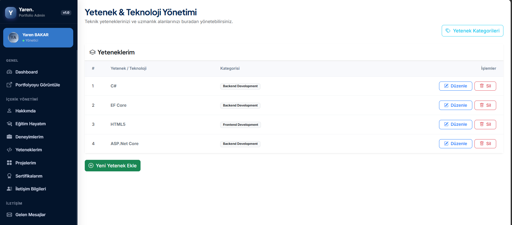

# MYAcademy Portfolio Project

ASP.NET Core MVC ile geliştirilmiş, veritabanı destekli ve yönetim panelinden yönetilebilen kişisel portfolyo web uygulaması. M&Y Yazılım Eğitim Akademi 12. Dönem 1. Proje case çalışması kapsamında hazırlanmıştır.

## Özellikler

**Kullanıcı arayüzü**
- Dinamik ana sayfa (ad, unvan, tanıtım metni, profil görseli, sosyal medya bağlantıları)
- Hakkımda, eğitim, deneyim, yetenek ve proje bölümleri
- İletişim formu (mesajlar veritabanına kaydedilir)
- [CV indirme butonu]

**Yönetim paneli (Admin Area)**
- Hakkımda, eğitim, deneyim, yetenek, sertifika, sosyal medya ve site ayarları için CRUD
- Proje yönetimi ve proje kategorileri (bire-çok ilişki)
- Mesaj kutusu (okundu/okunmadı, silme)
- Dashboard (istatistikler, son mesajlar, son projeler)
- [Eklediklerini yaz: SweetAlert2 bildirimleri, arama, vb.]

## Kullanılan Teknolojiler

- ASP.NET Core MVC ([.NET sürümü])
- Entity Framework Core (Code First)
- SQL Server
- Bootstrap, SweetAlert2
- View Component yapısı

## Kurulum

1. Repoyu klonla:
   ```bash
   git clone https://github.com/yaren-bakar/MYAcademy_PortfolioProject.git
   ```
2. `MYAcademy_PortfolioProject.sln` dosyasını Visual Studio ile aç.
3. `appsettings.json` içindeki connection string'i kendi SQL Server'ına göre düzenle.
4. Package Manager Console'da veritabanını oluştur:
   ```
   Update-Database
   ```
5. Projeyi çalıştır (F5).

Admin paneli: `/Admin/Dashboard`

## Proje Yapısı

```
Areas/Admin        → Yönetim paneli controller ve view'ları
Context            → PortfolioContext (EF Core DbContext)
Entities           → Veritabanı varlıkları
Migrations         → EF Core migration dosyaları
ViewComponents     → Ön yüz ve admin layout bileşenleri
wwwroot            → Statik dosyalar ve yüklenen görseller
```

## Ekran Görüntüleri

## Ekran Görüntüleri

### Ana Sayfa


### Admin Paneli





## Geliştirici

**Yaren Bakar**
[GitHub](https://github.com/yaren-bakar)
