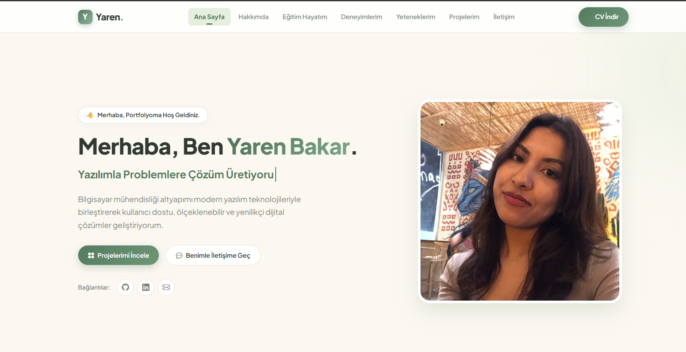
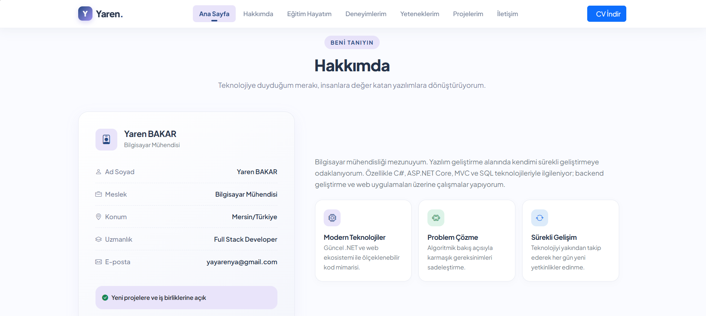
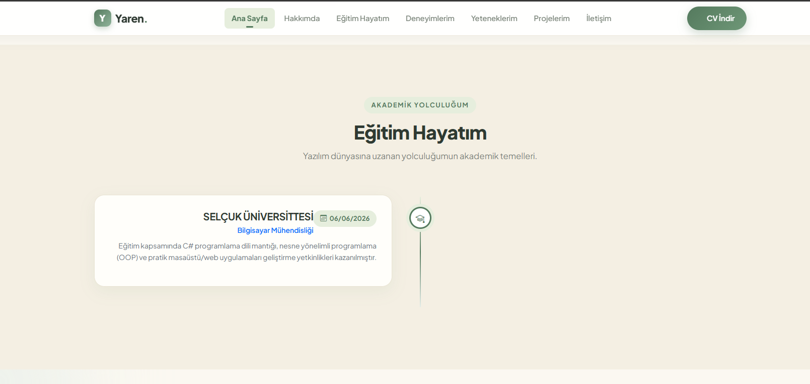
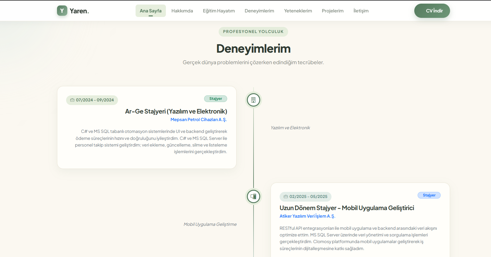
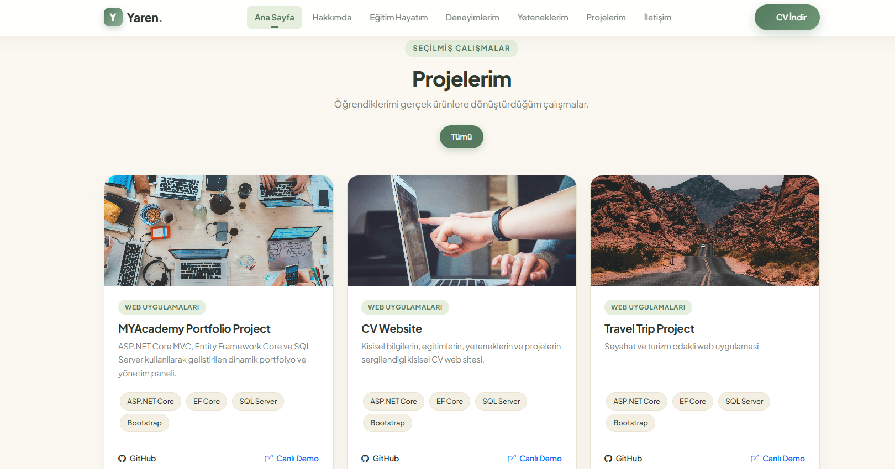
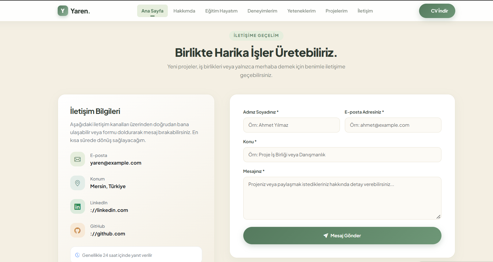
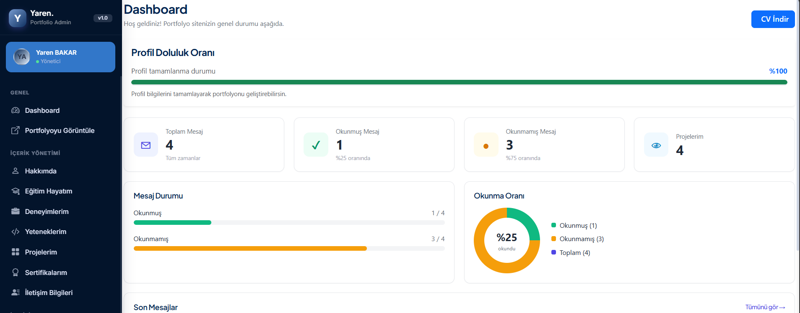
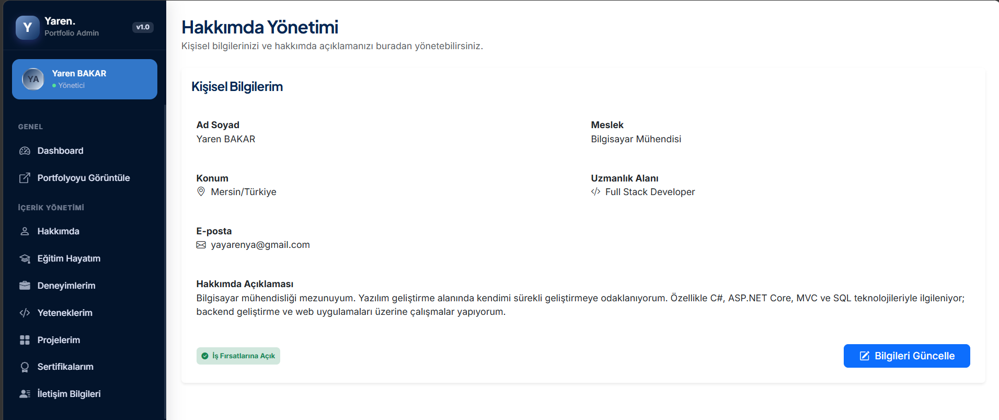
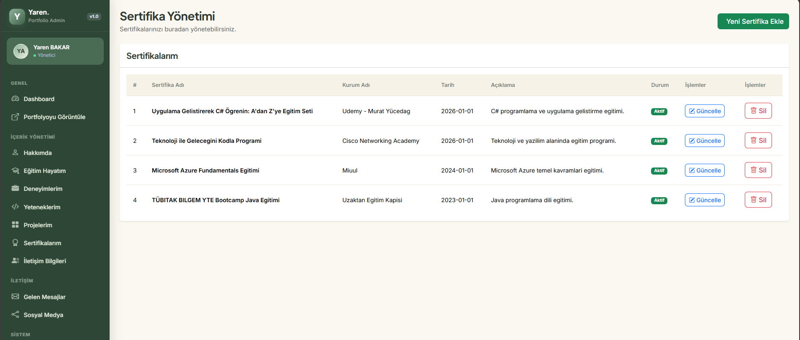

# MYAcademy Portfolio Project

ASP.NET Core MVC ile geliştirilmiş, veritabanı destekli ve yönetim panelinden tamamen yönetilebilen kişisel portfolyo web uygulaması. M&Y Yazılım Eğitim Akademi 12. Dönem Akşam Grubu 1. Proje case çalışması kapsamında hazırlanmıştır.

Ziyaretçiler portfolyo sitesinde profil, eğitim, deneyim, proje ve iletişim bilgilerini görür. Site sahibi ise Admin paneli üzerinden bu içeriklerin tamamını ekler, günceller ve siler. Admin panelinde yapılan her değişiklik ilgili sitede anında görünür.

---

## İçindekiler

- [Özellikler](#özellikler)
- [Ekran Görüntüleri](#ekran-görüntüleri)
- [Kullanılan Teknolojiler](#kullanılan-teknolojiler)
- [Mimari ve Proje Yapısı](#mimari-ve-proje-yapısı)
- [Veritabanı](#veritabanı)
- [Kurulum](#kurulum)
- [Geliştirici](#geliştirici)

---

## Özellikler

### Kullanıcı Arayüzü (Portfolyo Sitesi)

- **Ana sayfa (Hero):** Ad, unvan, tanıtım metni, profil görseli ve sosyal medya bağlantıları veritabanından dinamik olarak gelir.
- **Hakkımda:** Kişisel bilgiler ve öne çıkan yetenekler.
- **Eğitim ve Deneyim:** Kayıtlar zaman çizelgesi (timeline) şeklinde, tarih sırasına göre listelenir. Pasif olarak işaretlenen kayıtlar sitede görünmez.
- **Yetenekler:** Kategori bazında gruplanmış yetenekler.
- **Projeler:** Kartlar halinde listelenir, kategori adı gösterilir ve kategoriye göre filtrelenebilir.
- **Sertifikalar:** Alınan eğitim ve sertifikalar.
- **İletişim formu:** Ad, e-posta, konu ve mesaj alanları doğrulanır, gönderilen mesajlar veritabanına kaydedilir.
- **CV indirme:** Ana sayfadaki buton ile PDF formatında CV indirilir.
- **Tasarım:** Krem ve adaçayı yeşili tonlarında, responsive (mobil uyumlu) arayüz.

### Yönetim Paneli (Admin Area)

- **Dashboard:** Toplam mesaj, okunmuş ve okunmamış mesaj sayıları, toplam proje sayısı, son gelen mesajlar, son projeler ve profil doluluk oranı. Tüm veriler EF Core sorgularıyla üretilir, sabit değer yoktur.
- **İçerik yönetimi (CRUD):** Hero bölümü, Hakkımda, Eğitim, Deneyim, Yetenek ve Yetenek Kategorileri, Sertifikalar, Sosyal Medya hesapları ve Site Ayarları.
- **Proje yönetimi:** Proje ekleme, listeleme, güncelleme ve silme. Her proje bir kategoriye bağlıdır (bire-çok ilişki) ve kategori seçimi veritabanından gelen dropdown ile yapılır.
- **Mesaj kutusu:** İletişim formundan gelen mesajları listeleme, okundu olarak işaretleme ve silme.
- **Admin layout:** Sidebar, navbar, stil ve script bileşenleri View Component olarak ayrılmıştır.

---

## Ekran Görüntüleri

### Kullanıcı Arayüzü

#### Ana Sayfa


#### Hakkımda


#### Eğitim ve Deneyim

#### Eğitim


#### Deneyim


#### Projeler


#### İletişim


### Admin Paneli

#### Dashboard


#### Hakkımda Yönetimi


#### Sertifika Yönetimi


---

## Kullanılan Teknolojiler

| Alan | Teknoloji |
|---|---|
| Framework | ASP.NET Core MVC (.NET [SÜRÜMÜNÜ YAZ]) |
| ORM | Entity Framework Core (Code First) |
| Veritabanı | Microsoft SQL Server |
| Ön yüz | HTML5, CSS3, JavaScript, Bootstrap |
| İkonlar ve font | Font Awesome, Bootstrap Icons, Plus Jakarta Sans |
| Yapı | Areas, View Components, Migrations |

---

## Mimari ve Proje Yapısı

```
MYAcademy_PortfolioProject
├── Areas
│   └── Admin
│       ├── Controllers       → Yönetim paneli controller'ları
│       ├── Views             → Yönetim paneli sayfaları
│       └── ViewComponents    → Admin layout bileşenleri
├── Context                   → PortfolioContext (EF Core DbContext)
├── Controllers               → Portfolyo sitesi controller'ları
├── Entities                  → Veritabanı varlıkları
├── Migrations                → EF Core migration dosyaları
├── Models                    → ViewModel ve yardımcı modeller
├── ViewComponents            → Ön yüz layout ve bölüm bileşenleri
├── Views                     → Portfolyo sitesi sayfaları
└── wwwroot                   → Statik dosyalar, CV ve ekran görüntüleri
```

**Admin panelindeki controller'lar:** About, Certificate, Contact, Dashboard, Education, Experience, HeroSection, Message, Projects, SiteSetting, Skill, SkillCategory, SocialMedia

---

## Veritabanı

Veritabanı EF Core Code First yaklaşımıyla oluşturulur ve migration dosyaları repoda yer alır.

**İlişkili tablolar:** `Project` ve `Category` arasında bire-çok ilişki vardır. Her proje bir kategoriye bağlıdır (foreign key ve navigation property), kategori silinmeden önce bağlı projeler kontrol edilmelidir.

**Veri kaynağı:** Sitede gösterilen tüm içerik veritabanından gelir, admin panelinden yönetilir.

---

## Kurulum

### Gereksinimler

- [.NET SDK](https://dotnet.microsoft.com/download) ([SÜRÜMÜNÜ YAZ])
- Microsoft SQL Server (LocalDB ya da Express yeterlidir)
- Visual Studio 2022 (önerilir)

### Adımlar

1. Repoyu klonla:
   ```bash
   git clone https://github.com/yaren-bakar/MYAcademy_PortfolioProject.git
   cd MYAcademy_PortfolioProject
   ```

2. `MYAcademy_PortfolioProject.sln` dosyasını Visual Studio ile aç.

3. `appsettings.json` içindeki connection string'i kendi SQL Server bilgilerine göre düzenle.

4. Veritabanını oluştur. Package Manager Console'da:
   ```
   Update-Database
   ```
   ya da terminalde:
   ```bash
   dotnet ef database update
   ```

5. Projeyi çalıştır (F5 ya da `dotnet run`).

### Adresler

| Sayfa | Adres |
|---|---|
| Portfolyo sitesi | `/` |
| Admin paneli | `/Admin/Dashboard` |

### CV Dosyası

CV dosyası `wwwroot/files/` klasöründe tutulur. Kendi CV'ni kullanmak için bu klasördeki PDF dosyasını değiştirmen yeterlidir.

---

## Geliştirici

**Yaren Bakar**
Bilgisayar Mühendisi | .NET Backend Developer adayı

[GitHub](https://github.com/yaren-bakar)
